# KUST Dashboard Control Board

태양광 자동차 동아리 **KUST**의 2027 World Solar Challenge(WSC) 출전 차량에 들어가는 **계기판(디스플레이) 컨트롤 보드**입니다.
차량 CAN 버스에서 주행·배터리 데이터를 받아 운전자 앞 LCD에 표시하고, 핸들 버튼 입력을 CAN으로 다른 보드에 전달합니다.

회로 설계, 부품 선정, 4층 PCB 아트웍, 보드 검증, 펌웨어까지 **혼자 설계·제작**했습니다.

<p align="center">
  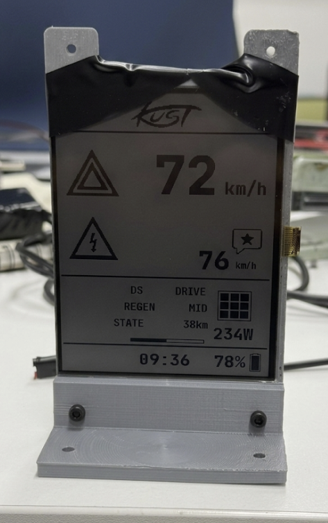
  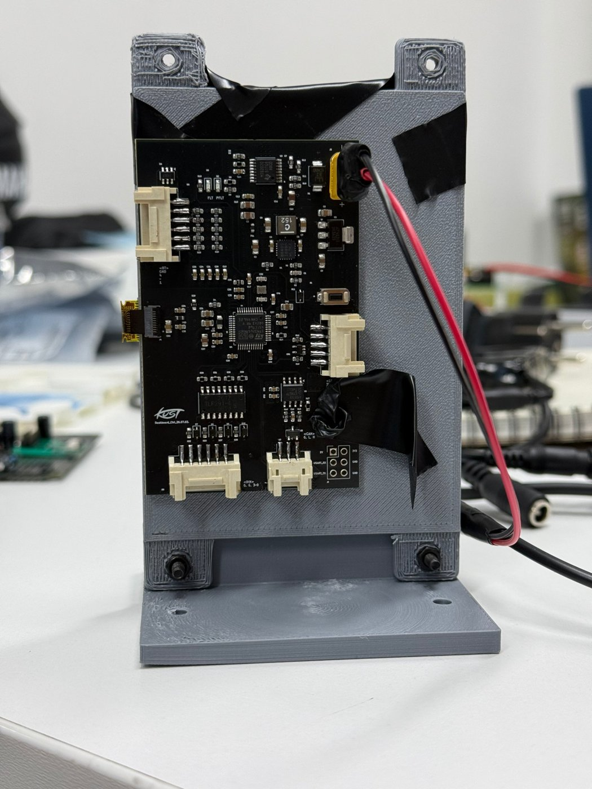
</p>

## 주요 사양 (V3)

| 항목 | 내용 |
|---|---|
| 입력 전원 | 차량 12V LV 라인 (XT30) |
| 소비 전류 | **약 0.4 mA @ 12V** (실측) |
| 전원 보호 | LM76202-Q1 차량용 eFuse: 역극성 −60V, UVLO 9V, OVP 16V, 전류 제한 1.2A / SMBJ24CA TVS |
| 전원 변환 | LT8640S 동기 벅 12V→5V (2MHz) → LT1963A LDO 5V→3.3V |
| MCU | STM32U545CET6Q (Cortex-M33 저전력, 내부 SMPS 사용) |
| 디스플레이 | Sharp Memory-in-Pixel LCD (SPI, 10핀 FPC) |
| 통신 | CAN 2.0 500 kbit/s (TJA1051T/3), 디버그 UART |
| 입력 | 핸들 버튼 5채널, 포토커플러 절연 디지털 입력 4채널 (TLP291-4) |
| PCB | 4층, 80 × 50 mm, KiCad, JLCPCB 제작 |
| 장착 위치 | 핸들 뒷면 |

## 시스템 구성

```
 차량 12V ──▶ [TVS] ─▶ [eFuse LM76202-Q1] ─▶ [LT8640S 12→5V] ─▶ [LT1963A 5→3.3V] ─▶ MCU / CAN / LCD
                        역극성·UVLO·OVP·과전류      2MHz 동기 벅          저노이즈 LDO
                        FAULT LED, IMON

 차량 CAN 버스 ◀──▶ [NUP2105L ESD] ◀──▶ [TJA1051T/3] ◀──▶ STM32U545 ──SPI──▶ Sharp Memory LCD
 핸들 버튼 5ch ──▶ [ESD 어레이] ──────────────────────────▶ STM32U545 (EXTI)
 외부 디지털 입력 4ch ──▶ [TLP291-4 포토커플러] ─────────────▶ STM32U545
```

### 펌웨어 데이터 흐름
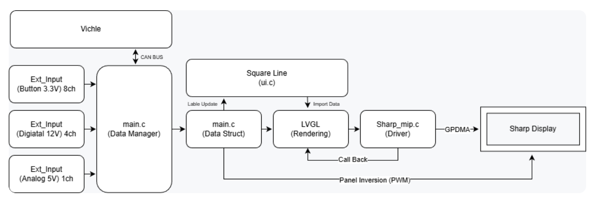

### 계기판 화면 (SquareLine Studio)
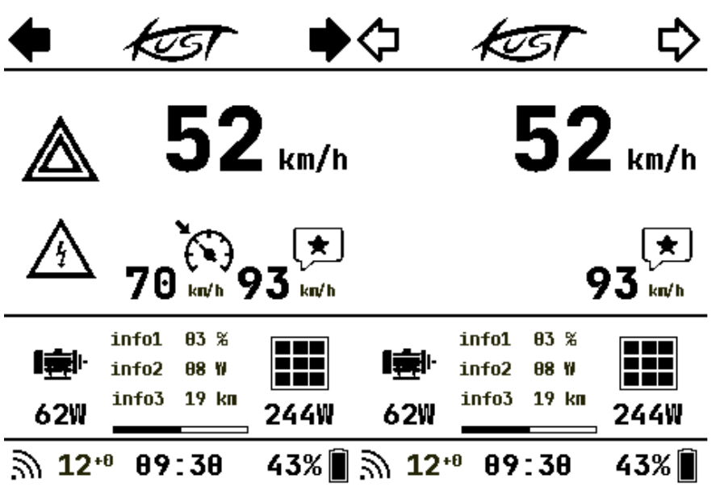

방향지시등·비상등·경고, 속도, ACC 설정 속도, 권장 속도, 모터·MPPT 전력, 통신 상태, 시간, 배터리 잔량(SOC)을 표시합니다. 왼쪽은 모든 표시를 켠 상태, 오른쪽은 일반 주행 상태입니다.

## 하드웨어 설계

### 1. 전원 보호부 — LM76202-Q1
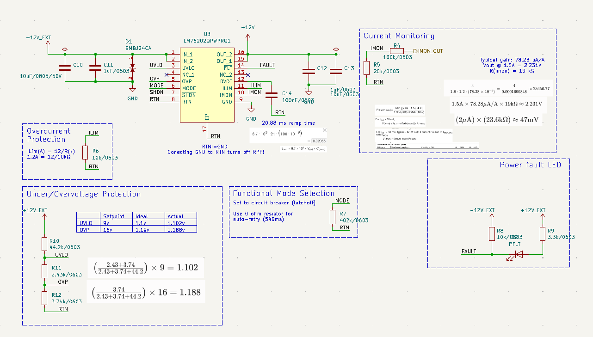

차량 LV 라인은 배선 실수(역극성), 부하 변동, 서지에 노출됩니다. 보호 소자를 따로 여러 개 두는 대신, 역극성 보호용 back-to-back MOSFET이 내장된 **AEC-Q100 eFuse(LM76202-Q1)** 하나로 보호 기능을 묶었습니다.

| 기능 | 설정 | 근거 |
|---|---|---|
| 저전압 차단(UVLO) | 9 V | 분압 44.2k / 2.43k / 3.74k → UVLO 핀 1.102 V (기준 1.1 V) |
| 과전압 차단(OVP) | 16 V | 같은 분압 → OVP 핀 1.188 V (기준 1.19 V) |
| 전류 제한 | 1.2 A | I_LIM = 12 / R(kΩ), R = 10 kΩ |
| 돌입 전류 제어 | 약 20.9 ms 상승 | dV/dt 커패시터 100 nF |
| 고장 동작 | Circuit breaker (latch-off) | 0 Ω으로 바꾸면 auto-retry |
| 상태 표시 | FAULT LED, IMON 전류 모니터 출력 | IMON은 ADC(PB1)로 연결 |

- 입력단에 **SMBJ24CA 양방향 TVS**를 두어 eFuse가 감당하기 전의 순간 서지를 클램프합니다.
- 회로도에 계산 과정과 근거를 메모로 남겨 두어, 후배가 저항값을 바꿀 때 바로 따라갈 수 있게 했습니다.

### 2. 전원 변환부 — LT8640S + LT1963A
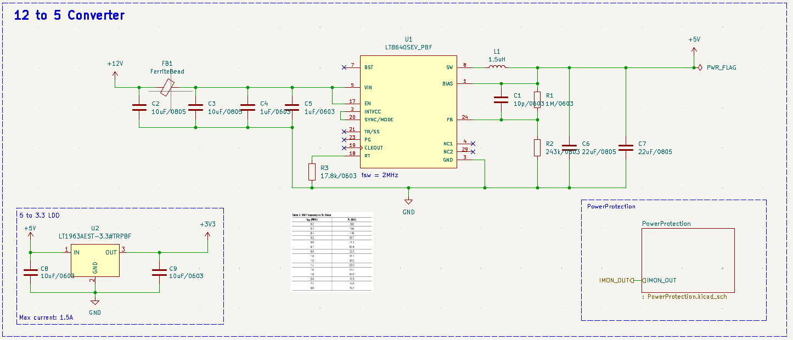

- **LT8640S (42V, Silent Switcher 2)**: 내부 바이패스 커패시터로 스위칭 노이즈가 작은 동기 벅입니다. 계기판 바로 옆에 CAN·LCD 신호가 지나가서 EMI가 적은 부품을 골랐습니다.
  - 출력: V_OUT = 0.97 V × (1 + 1 MΩ / 243 kΩ) ≈ **4.96 V**
  - 스위칭 주파수: R_T = 17.8 kΩ → **2 MHz** (AM 방송 대역 위쪽이고, 인덕터를 1.5 µH 소형으로 쓸 수 있음)
  - 입력단 페라이트 비드 + 10 µF ×2, 1 µF ×2 로 입력 리플이 12V 라인으로 돌아가지 않게 했습니다.
- **LT1963A-3.3 LDO**: 벅 출력의 리플을 한 번 더 걸러 MCU, CAN 트랜시버, LCD에 깨끗한 3.3V를 공급합니다.

### 3. MCU — STM32U545
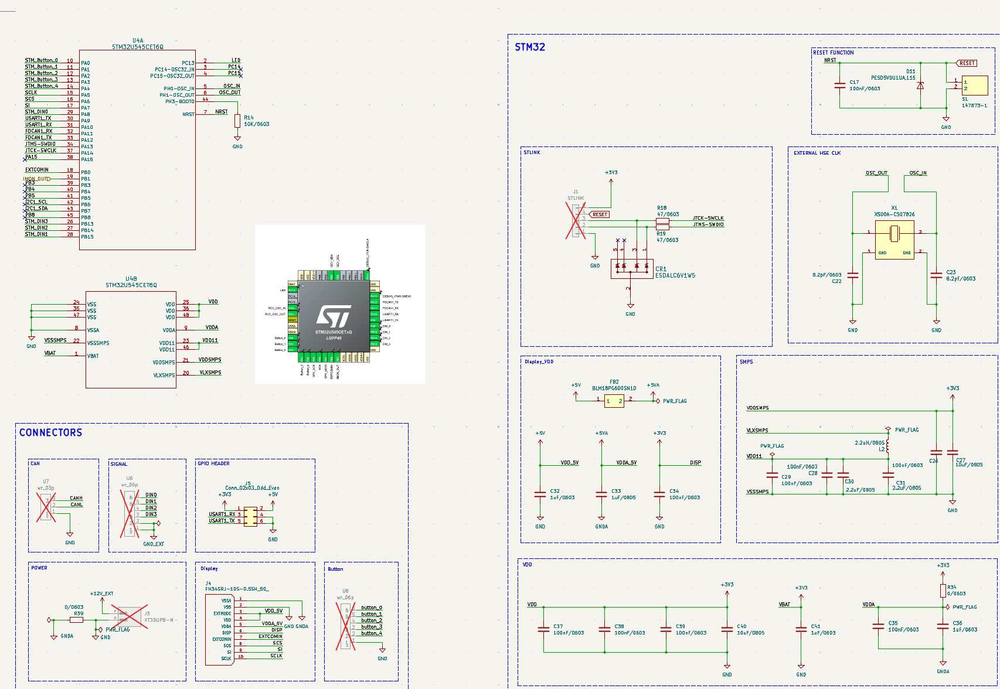

- 태양광 차량이라 전력 예산이 빠듯해서 **저전력 STM32U5 시리즈**를 선택했고, 내부 **SMPS(2.2 µH)** 를 사용해 코어 전원 효율을 높였습니다.
- 16 MHz 외부 수정 발진기(HSE)로 CAN 비트 타이밍을 안정적으로 맞췄습니다 (16 MHz / 32 tq = 500 kbit/s).
- 디스플레이 전원(5VA)은 **페라이트 비드로 분리**하고, 아날로그 GND(GNDA)는 0 Ω 저항 한 점으로만 디지털 GND와 연결했습니다.
- SWD 디버그 라인에는 직렬 47 Ω과 ESD 어레이, 리셋 버튼에는 ESD 다이오드를 넣었습니다.

| 기능 | 핀 |
|---|---|
| 핸들 버튼 0~4 | PA0~PA4 (EXTI) |
| LCD SPI (SCK / MOSI / SCS) | PA5 / PA7 / PA6 |
| LCD EXTCOMIN | PB0 (TIM3_CH3) |
| IMON (전류 모니터) | PB1 (ADC1_IN16) |
| 디지털 입력 0~3 | PA8, PB15, PB14, PB13 |
| CAN | PA11 RX / PA12 TX (FDCAN1, Classic CAN) |
| 디버그 UART | PA9 / PA10 (USART1) |

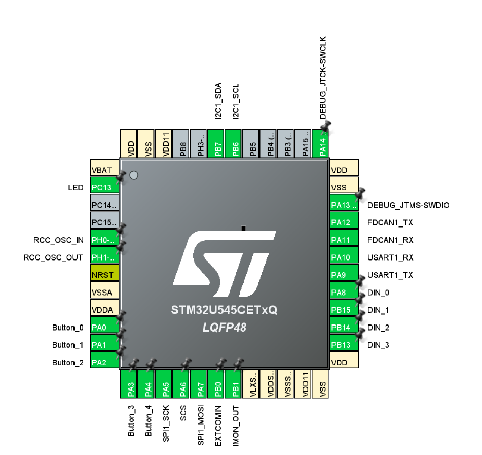

### 4. CAN 인터페이스
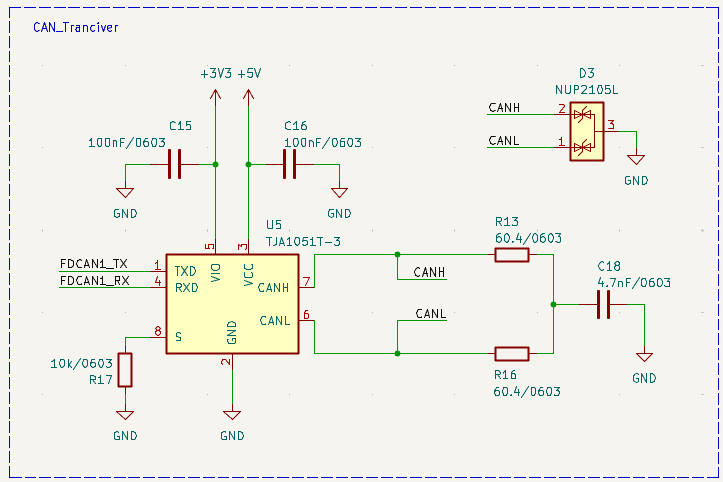

- **TJA1051T/3**: VIO 핀으로 3.3V MCU와 직접 연결되는 CAN 트랜시버.
- **Split termination**: 60.4 Ω × 2 + 4.7 nF로 공통 모드 노이즈를 GND로 빼서 EMI를 줄였습니다.
- **NUP2105L**: CAN 전용 ESD 보호 다이오드를 커넥터 가까이 배치.

### 5. PCB 아트웍 (4층, 80 × 50 mm)

| 전체 레이어 | Bottom |
|---|---|
| 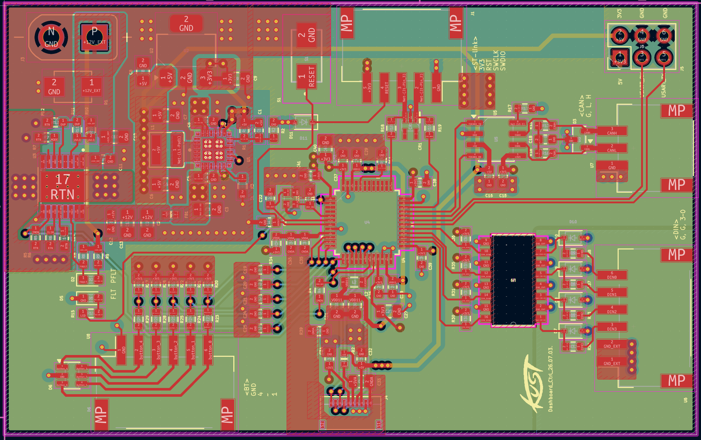 | 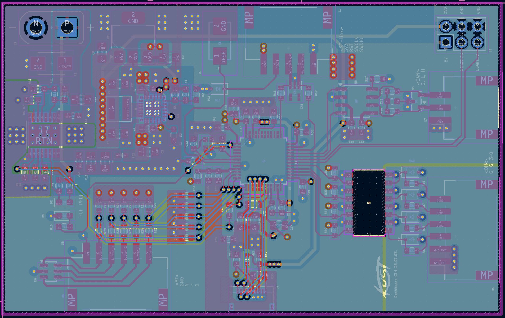 |
| **In1** | **In2** |
| 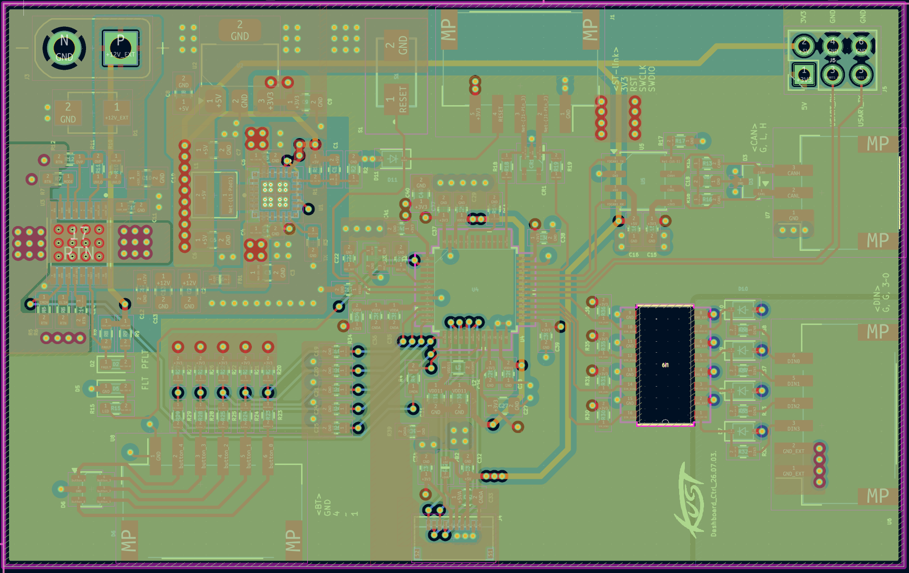 | 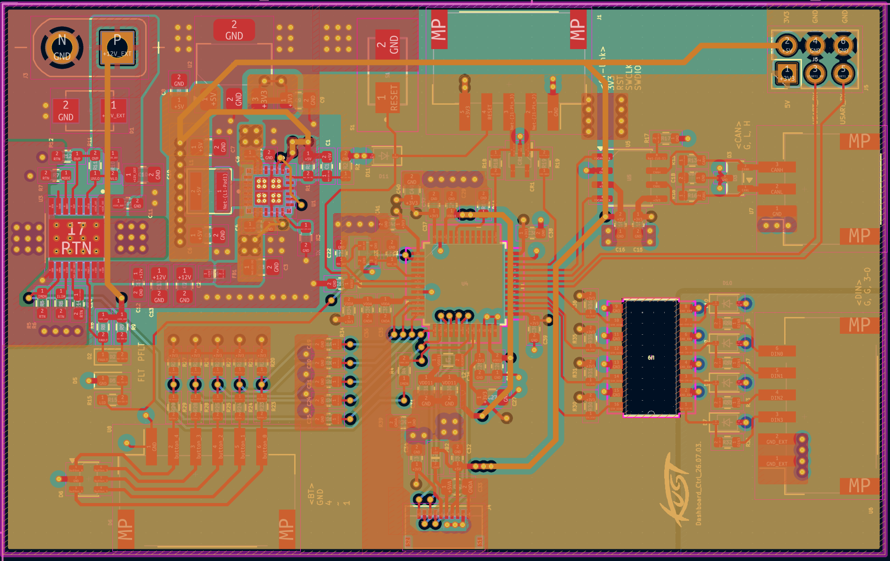 |

- 핸들 뒷면에 붙이기 위해 V2보다 크기를 줄이고, 커넥터를 보드 가장자리로 모아 배선이 핸들 안쪽으로 빠지게 했습니다.
- 전원부(eFuse, 벅, LDO)를 보드 왼쪽 위에 몰아 스위칭 루프를 짧게 하고, CAN·LCD·MCU와 거리를 두었습니다.
- 내층을 GND 플레인으로 써서 신호의 귀환 경로를 확보하고, eFuse의 RTN(역극성 보호 기준)은 GND와 따로 영역을 나눴습니다.
- eFuse·벅 아래에 비아를 여러 개 두어 열을 내층과 아랫면으로 퍼뜨렸습니다.

## 버전 이력

| 버전 | 시기 | 내용 |
|---|---|---|
| V1 | 2026 초 | 만능기판 프로토타입. Sharp LCD 구동과 UI 확인 |
| V2 | 2026.03 ~ 04 | 첫 PCB (STM32U535). 보드 안에 컨버터 없이 외부 전원 사용 (`Hardware/V2`) |
| **V3** | 2026.07 ~ 08 | 전원 보호부(eFuse)와 12V→5V→3.3V 컨버터를 보드에 통합. 팀 요구에 맞춰 통신·입력 커넥터 재구성, 핸들 뒷면 장착을 위해 소형화 (`Hardware/V3`) |

<p align="center">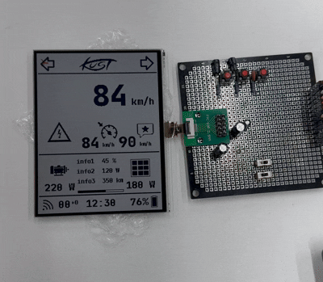</p>

## 검증

PCB를 받은 뒤 감에 의존하지 않고 아래 순서로 한 단계씩 확인했습니다.

| 단계 | 내용 | 결과 |
|---|---|---|
| 1. 외관·단락 점검 | 납땜 상태, 전원–GND 저항 측정 | (사진 추가 예정) |
| 2. 전원부 단독 확인 | 12V 인가 후 5V, 3.3V 출력 측정 | ✅ 아래 사진 |
| 3. MCU 부팅 | SWD 연결, 펌웨어 업로드 | (사진 추가 예정) |
| 4. 통신·표시 | CAN 송수신, LCD 표시 | ✅ 계기판 동작 화면 |

### 2. 전원부 출력 측정
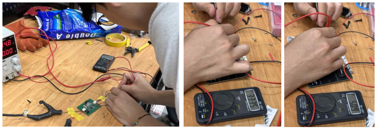

파워 서플라이로 12V를 인가하고 멀티미터로 LDO 출력(3.3V)과 벅 출력(5V)을 측정했습니다.

| 측정 항목 | 설계값 | 측정값 |
|---|---|---|
| 12V 입력 소비 전류 | - | 약 0.4 mA |
| 벅 출력 (5V) | 4.96 V | 약 4.9 V |
| LDO 출력 (3.3V) | 3.3 V | 3.35 V |

### 추가 예정
- [ ] 외관·단락 점검 사진
- [ ] 오실로스코프: 벅 출력 리플, 스위칭 노드 파형
- [ ] 오실로스코프: CANH / CANL 파형
- [ ] 소비 전류 측정 사진
- [ ] 차량(핸들) 장착 사진

## 펌웨어 (`Firmware/`)

STM32CubeIDE + HAL, UI는 LVGL 8.3 + SquareLine Studio로 만들었습니다. 펌웨어는 하드웨어를 검증하고 차량에서 쓰기 위한 최소 기능 위주입니다.

| 모듈 | 역할 |
|---|---|
| `can_bus.c` | FDCAN 초기화, 수신 인터럽트, bus-off 감지 후 200 ms마다 재시도 |
| `can_app.c` | 주행 데이터(0x501) 해석, 600 ms 무수신 시 끊김 판정, ACC 명령(0x510) 200 ms 주기 송신 |
| `can_text.c` | 지상국 텍스트 메시지(0x500) 여러 프레임 조립 |
| `SHARP_MIP.c` | Sharp Memory LCD SPI 드라이버 |
| `dashboard_ui.c` | 속도, SOC, 전력, 경고 표시 |
| `imon.c` | eFuse IMON 전류 ADC 측정 (직렬 100 kΩ 때문에 샘플링 시간 814.5 cycle) |
| `debug_log.c` | 디버그 로그, 수신 주기·지터 통계, 시험용 CAN 프레임 주입 |

### CAN 메시지 (500 kbit/s, 표준 11bit ID)

| ID | 방향 | 주기 | 내용 |
|---|---|---|---|
| 0x500 | 통신보드 → 계기판 | 이벤트 | 텍스트 메시지 (byte0 = 마지막 플래그 + 시퀀스, byte1~7 = 본문) |
| 0x501 | 통신보드 → 계기판 | 200 ms | 속도(0.01 m/s), 전류(0.1 A), SOC(0.1 %), 전력(1 W), 각 2바이트 리틀엔디안 |
| 0x510 | 계기판 → 통신보드 | 200 ms | byte0 = ACC 설정 속도(km/h), byte1 = ACC on/off |

## 폴더 구조

```
├── Hardware/
│   ├── V3/          최신 보드 (KiCad 회로도·PCB, STEP, BOM, 거버)
│   └── V2/          이전 보드
├── Firmware/        STM32CubeIDE 프로젝트 (STM32U545)
└── docs/images/     회로도, 아트웍, 실물 사진
```

## 사용 도구
KiCad · STM32CubeIDE / CubeMX · LVGL · SquareLine Studio · 멀티미터 · 오실로스코프
